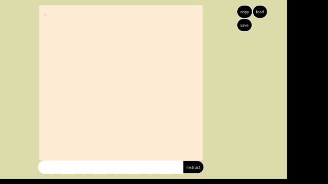

# Voxdocs



[Try it out here!](https://voxdocs.brianrayburn.tech)

## Summary

This app was created as a simple example of building a UI utlizing OpenAI's APIs for data transforms.

## Setup

To use nix, make sure you have nix and devenv installed (and optionally direnv)

### Install dependencies

#### w/ Nix

This project is setup to use [`devenv`](https://devenv.sh) to manage a development environment, including dependencies and process management.
Assuming you have nix, devenv, and direnv installed, you need to `cd` into the root of the repo, then run `direnv allow` to install all of the dependencies used in the repo (or `devenv shell` if you aren't using direnv).

The development shell installs both the client and server dependencies automatically.

#### w/o Nix

#### Install Dependencies

**Base dependencies:**

- Node.js 22 and pnpm (the version pinned in `package.json`; enable it with `corepack enable`)

**Libraries:**

- `pnpm install --frozen-lockfile`
- `pnpm --dir server install --frozen-lockfile`

### Create .env file

Please add a `.env` file to the root of the repo based on the `.env.example` file.

## Usage

### w/ Nix

In the root of the repo run `devenv up` to start the server.

### w/o Nix

#### 1. Start everything up

`pnpm exec concurrently "pnpm dev" "pnpm --dir server dev"` to run everything in one terminal.

## Testing

Use Node.js 22 and install both packages (`pnpm install --frozen-lockfile` and `pnpm --dir server install --frozen-lockfile`). Run test commands from the repository root:

| Command              | Purpose                                                           |
| -------------------- | ----------------------------------------------------------------- |
| `pnpm test`          | Run Vitest unit, React rendering, and API integration tests once  |
| `pnpm test:watch`    | Re-run affected tests while developing                            |
| `pnpm test:coverage` | Report coverage and write an HTML report to `coverage/index.html` |
| `pnpm test:e2e`      | Run the Chromium browser smoke test                               |

Before the first browser run, install Chromium with `pnpm exec playwright install chromium` (on Linux CI, use `pnpm exec playwright install --with-deps chromium`). Playwright starts Vite automatically.

On NixOS, use a system Chromium with its runtime dependencies: `PLAYWRIGHT_CHROMIUM_EXECUTABLE_PATH="$(command -v chromium)" pnpm test:e2e`.

### Strategy

- **Unit tests:** protect Markdown task-marker changes and AI request/response handling, including malformed responses and provider failures.
- **React tests:** render the actual Markdown pipeline in jsdom to check checkbox interaction for nested, ordered, quoted, and loose lists.
- **API integration tests:** exercise Express through Supertest, mocking only the AI utility. The app is exported separately from the listening server so tests do not start the production listener.
- **Browser smoke test:** exercises instruction submission, rendered output, checkbox editing, persistence after reload, and a follow-up instruction containing the current document.

Tests use mocked AI responses and need no API key, running backend, or paid API calls. They check application behavior, not live model quality. Add regression cases alongside affected code (`*.test.ts` / `*.test.tsx`); browser scenarios live under `tests/e2e/`.

GitHub Actions runs coverage, both builds, and the browser test on pushes and pull requests. Coverage reports and failure traces are uploaded as artifacts. Coverage is initially informational, with no percentage gate. Existing linting remains available through `pnpm lint` and the devenv pre-commit hooks.

## Deployment

### Automatic deployment

Every push to `main`, including merged pull requests, runs CI and deploys to the
existing Fly.io app only after tests, both builds, and the browser smoke test pass.
The deployment workflow uses the `dist/` artifact from that CI run to build and
push the existing devenv container, then runs `flyctl deploy`. Deployments are
serialized to avoid overlapping releases.

Add a GitHub Actions repository secret named `FLY_API_TOKEN` under **Settings →
Secrets and variables → Actions**. Generate an app-scoped deploy token with:

```sh
flyctl tokens create deploy --app voxdocs
```

The Fly.io app, volume, and runtime secrets must already be configured as described
below. Pull request CI runs do not deploy.

### Build the app

#### w/Nix

Run `build` in the root of the repo to build the app.

#### w/o Nix

Run `pnpm build` in the root of the repo to build the client app.
Run `pnpm --dir server build` to build the server app.

### Build and deploy the container

Login:

```
flyctl auth login
```

Make sure Dockers logged in:

```
flyctl auth docker
```

Create an app (only the first time):

```
flyctl apps create voxdocs
```

Allocate ipv4 (only the first time):

```
flyctl ips allocate-v4
```

Copy the container to fly.io registry:

```
devenv container copy voxdocs
```

Create a volume for `devenv` state (only the first time):

```
flyctl volumes create devenv_state --region ams --size 1
```

Deploy your app:

```
flyctl deploy
```
